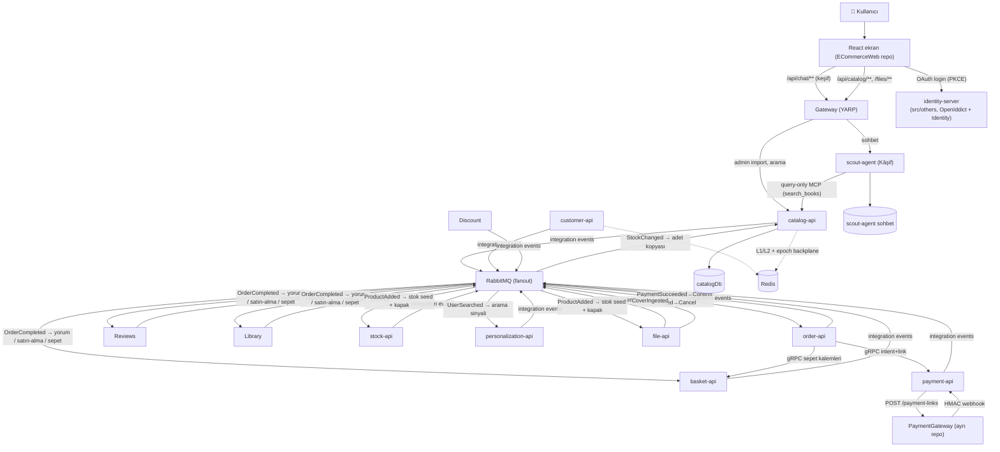

# ECommerceAgent — Olay-Güdümlü Kitapçı + LLM Keşif Agent'ı

> Domain-Driven, olay-güdümlü mikroservis **kitapçı backend'i** (fiziki kitap) — uçtan uca **.NET
> Aspire** ile orkestre; yüzeyi **first-party React ekran + REST API + LLM sohbet agent'ı ("Kâşif")**.
> Kullanıcı doğal dille konuşur, agent niyeti **tipli** çıkarıp Catalog'un **ParadeDB BM25** aramasını
> sürer. **k3s + GitHub Actions push-CD** ile canlıda.

<p>
  
  
  
  
  
  
  
  
  
  
  
  
</p>

## Genel Bakış

Her servisin kendi veritabanına sahip, izole bir **bounded context** olduğu mikroservis backend'i.
Context'ler arası iletişim yalnızca **integration event** (RabbitMQ fanout; checkout dahil —
koreografi) ve sanksiyonlu **tipli gRPC** (sepet kalemleri, ödeme intent+link) üzerindendir.

- **Katalog verisi:** admin Excel import'uyla (çok-sayfalı Kitapyurdu kazıması, ~23.6k kitap);
  INSERT-only, iki-faz (dry-run → onay → yazım), arka plan iş. Ürün fiyatsız/yazarsız doğabilir
  (katalogda görünür, satılamaz); `IsSalable` = fiyat>0 ∧ stok>0 ∧ ≥1 yazar.
- **Keşif yüzeyi:** React ekran (ayrı repo `ECommerceWeb`) → YARP Gateway → servisler. Kitap keşfi
  **"Kâşif" sohbet agent'ı** üzerinden: doğal dil → **iki-faz tipli niyet-çıkarma** (LLM structured
  output → tipli slot) → deterministik → Catalog `search_books` MCP tool'u → kartlar.
- **Arama:** Catalog içinde **ParadeDB pg_search BM25** tek motor (metin + facet + sort + browse tek
  SQL); içerik-temelli keşif ekseni kapalı-sözlük taksonomi (`Genre`/`Moods`/`Themes`/`AudienceLevel`).
- **Kimlik:** çözüm içinde (`src/others/Identity.Server`) — OpenIddict + ASP.NET Identity, rol→scope RBAC.

DDD, CQRS, olay-güdümlü tasarım ve prodüksiyonda **güvenilir LLM entegrasyonunun** .NET'te ne kadar
ileri taşınabileceğini gösteren bir portföy / öğrenme projesidir.

## Bu proje neyi gösteriyor

- **Bounded-context izolasyonu** — kendi PostgreSQL veritabanı + Marten şeması olan DB-sahibi
  context'ler. Paylaşılan domain modeli yok; aynı kavram (*Ürün*) her context'te farklı modellenir.
- **Zengin aggregate'ler ve zorunlu invariant'lar** — iş kuralları handler'da değil aggregate'in
  içinde (private koleksiyon, davranış metotları). Geçersiz durumlar temsil edilemez.
- **Vertical Slice + CQRS** — kod feature'a göre örgütlenir; repository yok, handler doğrudan Marten
  `IDocumentSession` kullanır.
- **LLM keşif agent'ı ("Kâşif", Microsoft.Agents.AI + MCP)** — kitap keşfi iki-faza bölünür:
  (1) `/extract` LLM **strict structured output** ile ham sorguyu **tipli niyet objesine** çıkarır
  (çeviri/enum/id yok — yalnız kullanıcının kelimelerini doğru slota koyar, uydurma yasağı);
  (2) `/search` deterministik yorumlar + Catalog'un **query-only MCP** tool'uyla arar. Tek LLM turu,
  model-agnostik güvenilirlik. Yazar adı serbest metne değil `author` filtresine gider (token
  kirliliği biter). Çok-turlu daraltma ("X'in kitapları" → "sadece Y yayınevi" = kesişim).
- **ParadeDB BM25 birleşik arama** — metin + yapısal facet (tür/ton/konu/yaş kapalı-sözlük) + sort +
  browse tek `SearchAsync` SQL'inde; Marten LINQ dışı ham `NpgsqlDataSource`.
- **Exception yerine Result pattern** — beklenen hatalar tipli `Result` nesneleriyle akar.
- **Scope-tabanlı yetkilendirme** — OpenIddict + ASP.NET Identity (çözüm-içi IdP); servisler OAuth
  **scope**'larına göre yetkilendirir (rol = scope demeti; downstream rolü görmez).
- **Checkout koreografisi** — merkezi orkestratör yok: `PaymentSucceeded → Order.Confirm →
  OrderCompleted` fanout (Reviews yorum-hakkı + Library satın-alma + Basket temizliği) /
  `PaymentFailed → Cancel`; her tüketim idempotent (durum-guard'lı), teknik hata retry → DLQ.
- **Pay-by-link ödeme** — kart alanı sistemden hiç geçmez: Order→Payment S2S gRPC intent+link,
  EC→PG `POST /payment-links` REST, PG→EC **HMAC webhook** (fail-closed, anti-tamper tutar guard'ı).
- **Excel import boru hattı** — admin çok-sayfalı xlsx yükler → arka plan iş INSERT-only işler
  (ISBN varsa dokunma) → `ProductAdded` → stok seed + kapak zinciri (File BC → R2 → `CoverIngested`).
- **Bildirimsel caching + durable invalidation** — okuma sorguları `[Cached(...)]` (HybridCache L1 +
  Redis L2); boşaltma **epoch-key** deseni (durable mesaj → Redis `INCR`, backplane pub/sub).
- **Tek komutla orkestrasyon** — .NET Aspire tüm servisleri + Postgres + RabbitMQ + Redis + IdP'yi
  service discovery + connection-string enjeksiyonuyla ayağa kaldırır.
- **Spec-driven development** — önemsiz olmayan feature'lar spec-kit akışıyla, proje anayasasının
  yönetiminde; her BC'nin domain süreci `FLOW.md`'de (EventStorming irtifası).

## Mimari



Durum değişiklikleri RabbitMQ fanout exchange'lerinde **integration event** olarak yayılır. Olaylar
dışında senkron kanal sanksiyonlu **gRPC**'dir; HTTP istisnaları dış-sağlayıcı webhook'u (PG callback)
+ File kapak serve/S2S + Gateway/REST yüzeyidir.

## Teknoloji Yığını

| Alan | Teknoloji |
|------|-----------|
| Çalışma zamanı | .NET 10, C# (nullable + implicit usings) |
| Orkestrasyon | .NET Aspire (AppHost + ServiceDefaults) |
| Kalıcılık | Marten (PostgreSQL document / event store) |
| Arama | **ParadeDB `pg_search` BM25** — Catalog içi tek motor (metin+facet+sort+browse) |
| Bus & messaging | Wolverine (CQRS bus + RabbitMQ fanout) |
| Caching | HybridCache (L1 + Redis L2), AOP decorator; epoch-key durable invalidation |
| Kimlik & yetki | **Çözüm-içi** `src/others/Identity.Server` (OpenIddict + ASP.NET Identity; OIDC/OAuth, scope-tabanlı) |
| LLM agent | Microsoft.Agents.AI + MCP (agent-içi, query-only); OpenAI gpt-4o-mini (structured output) |
| Yüzey | YARP Gateway + React (ayrı repo `ECommerceWeb`) |
| Senkron RPC | gRPC (sepet kalemleri, ödeme intent+link) |
| DI | Scrutor (konvansiyon-tabanlı otomatik kayıt) |
| Test | xUnit + Shouldly (saf domain birim testleri) |

## Servisler

| Proje | Sorumluluk |
|---------|----------------|
| `catalog-api` | Zengin `Product` + `Author` + `Publisher`; kapalı-sözlük taksonomi (Genre/Moods/Themes/Audience) + eser `WorkKey`; ParadeDB BM25 arama; Excel import (admin, iki-faz INSERT-only); stok/indirim adet-kopyaları (StockChanged/ProductDiscountChanged-fed) |
| `scout-agent` | **"Kâşif" LLM sohbet agent'ı** — iki-faz tipli niyet-çıkarma (`/extract` structured output → `/search` deterministik); Catalog query-only MCP; login sohbet kaydı (Claude-tarzı sidebar); sesle-soru (STT) |
| `basket-api` | Kalıcı sepet + kalem; sahip = login kullanıcı; dijital değil fiziki — stok Stock BC'de; Order'a sepet-kalemleri gRPC |
| `order-api` | Sipariş aggregate + yaşam döngüsü; pay-by-link (gRPC intent+link); `PaymentSucceeded`→Confirm+`OrderCompleted` fanout / `PaymentFailed`→Cancel |
| `payment-api` | `PaymentIntent` durum makinesi (kart alanı yok, `TxRef` unique); Order S2S gRPC + EC→PG REST + PG→EC HMAC webhook → fanout |
| `customer-api` | AddressBook (≤1 varsayılan invariant'ı); izole, event yaymaz; Order'a varsayılan-adres gRPC (uykuda) |
| `reviews-api` | Satın-alma şartlı yorum; hak `OrderCompleted`-fed lokal read-model; yorum hemen görünür (moderasyon yok), özet okuma anında |
| `library-api` | Kullanıcı-ürün ilgi kayıtları; `UserPurchase` satın-alma birikimi (`OrderCompleted` upsert); fiyat alarmı uykuda |
| `stock-api` | Kurgusal envanter (`StockItem`, OnHand≥0); adedin tek yazarı; her değişimde `StockChanged` → Catalog adet-kopyası |
| `discount-api` | Kampanya modeli (`Campaign`, oran %1-90 + zaman penceresi); `ProductDiscountChanged` → Catalog oran-kopyası; liste fiyatını ezmez |
| `file-api` | Kapak kayıt defteri (`FileAsset`, ISBN unique) + çoklu fiziki depo (`IFileStore`: R2/Local); `ProductAdded` → kapak yükle → `CoverIngested`; anonim `/files/v1/covers/{isbn}` serve |
| `personalization-api` | Login arama sinyali deposu (`UserSearched`-fed) + arama-geçmişi HTTP yüzeyi (JWT zorunlu, kullanıcı kendi kaydını siler) |
| `identity-server` | **Çözüm-içi** (`src/others`): OpenIddict (code+PKCE + m2m + refresh) + ASP.NET Identity + rol→scope RBAC + server-rendered `/Admin/*`; Google ile giriş (koşullu) |

Paylaşılan temeller `src/others` altında: `Common` (domain yapı taşları, result, caching, auth) +
`Shared` (integration-event kontratları + gRPC protolar); `Gateway` (YARP).

**Söküldü (gerekçeler `docs/adr/` + Obsidian spec damıtması):** Storefront + Elasticsearch (arama
ParadeDB BM25'e katlandı), dış/BYO MCP yüzeyi (agent-içi query-only MCP geri geldi), çok-tedarikçi
besleme hattı, Checkout.Orchestrator (koreografiye geçildi), semantik/pgvector arama ayağı (ileride
yeni spec), ScoutAgent `/messages` router+sub-agent (iki-faz tipli aramaya evrildi).

## Öne Çıkan Tasarım Kararları

- **Bir mikroservis = bir bounded context.** Ayrı veritabanı, ayrı şema, ayrı domain modeli.
- **Aggregate'ler invariant'larının sahibidir.** Yeni kural handler'a değil aggregate metoduna gider.
- **LLM dar bir işe hapsedilir, yürütme deterministiktir.** Agent yalnız niyeti **tipli şemaya**
  çıkarır (structured output); yorumlama + arama koddadır. Zar-atan tool-calling yerine güvenilir,
  model-agnostik akış — prodüksiyon LLM uygulamalarının yakınsadığı desen.
- **Exception yerine Result.** Handler, aggregate metodu ve endpoint `Result` döner.
- **Orkestrasyon yerine koreografi.** Checkout merkezi saga değil event zinciridir; her tüketim
  idempotent, takılma durable mesaj + DLQ ile görünür.
- **Hosted ödeme.** Kart verisi mağazaya hiç girmez; doğrulama sunucu-tarafı HMAC webhook'ta.
- **Rol downstream'e sızmaz — yalnız scope.** IdP rol verir (rol = scope demeti).
- **Sır insan-yüzeyde görünmez.** Credential/PII ekrana/chat'e/log'a yazılmaz (kontrol-düzlemi ≠ veri).

## Dağıtım (CI/CD + k3s) — CANLI

Üç repo (**ECommerceAgent** + **Identity/AgentPlatform** + **PaymentGateway**) tek bir **k3s**
cluster'ına **GitHub Actions push-tabanlı CD** ile deploy edilir; frontend `ECommerceWeb` kendi
CD'siyle aynı cluster'a. Canlı.

- **k3s tek-node** — hafif, pilleri-dahil (containerd + traefik + coredns).
- **Push-CD, SSH yolu** — k3s API internete kapalı; runner SSH'la `kubectl`'i sunucuda koşar.
- **Image:** `aspire do push` (Dockerfile'sız) → GHCR `:latest`; deploy'da `ghcr-pull` secret güncel
  PAT'le tazelenir, `rollout restart` + `rollout status`.
- **DNS/TLS:** cert-manager/Let's Encrypt; app `hasancagridemiriz.com`, IdP `id.hasancagridemiriz.com`.
- **Reverse-proxy kuralı:** ingress TLS arkasındaki servisler `ForwardedHeaders` yapılandırır.

Gerekçeler: **[`docs/adr/adr-k3s-push-cd-deployment.md`](docs/adr/adr-k3s-push-cd-deployment.md)**.

## Başlangıç

### Ön koşullar
- [.NET 10 SDK](https://dotnet.microsoft.com/) · Docker (Aspire; Postgres/ParadeDB, RabbitMQ, Redis)

### Tüm sistemi çalıştır
Dağıtık sistemi her zaman **Aspire AppHost**'tan başlat — servisler birbirini, DB'leri, RabbitMQ'yu
service discovery ile bulur. Tek API bağımsız açılmaz. Kimlik makamı **çözüm içinde** (AppHost başlatır).

```bash
# Repo kökünden
dotnet run --project src/aspire/AppHost/AppHost.csproj
```

Keşif ekranı ayrı repo (`ECommerceWeb`, React + Vite `:5173`); gateway'e proxy'ler. IdP **HTTPS**
üzerinde koşar (issuer `https://localhost:5001`).

### Derle & test et
```bash
dotnet build
dotnet test
dotnet test tests/Catalog.Api.Tests/Catalog.Api.Tests.csproj   # tek proje
```

## Proje Yapısı

```
src/
  aspire/        AppHost (orkestrasyon) + ServiceDefaults
  agents/        scout-agent (Kâşif LLM sohbet agent'ı)
  services/      basket, catalog, customer, discount, file, library,
                 order, payment, personalization, reviews, stock
  others/        Common, Shared (kontratlar + protolar), Gateway (YARP), Identity.Server
tests/           Servis başına saf domain birim testleri (xUnit + Shouldly)
.specify/ specs/ Spec-driven development (spec-kit) kurulumu + feature artefaktları
docs/adr/        Mimari karar kayıtları
```

Her bounded context bir `FLOW.md` taşır — iş adımlarını, invariant'larını ve sınırını EventStorming
irtifasında anlatan domain-süreç belgesi.

## Notlar

- **Central Package Management** açık — paket sürümleri `Directory.Packages.props`'ta yaşar.
- `InvariantGlobalization=true` repo-geneli (Marten tr-TR noktasız-ı tuzağını + ClosedXML virgül
  bug'ını kökten çözer).
- Önemsiz olmayan feature'lar **spec-kit** akışıyla, `.specify/memory/` anayasasının yönetiminde.

---

*Domain-Driven mikroservislerin + prodüksiyonda güvenilir LLM entegrasyonunun .NET yığınında pratik keşfi.*
