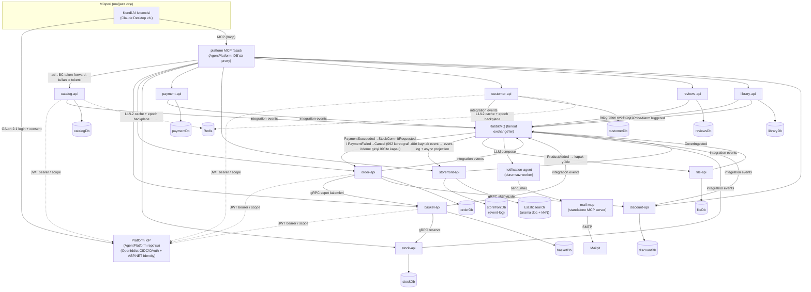

# Agent Framework ile E-Ticaret

> Olay-güdümlü, Domain-Driven mikroservis e-ticaret platformu — müşteri yüzeyi tamamen **kendi getirdiğin AI istemcisi** (Claude Desktop vb.) üzerinden, uçtan uca **.NET Aspire** ile orkestre.

📖 **Müşteri misin?** [Kullanım kılavuzu](docs/kullanim-kilavuzu.md) — bağlan, "merhaba" yaz, gerisi asistanın işi.

<p>
  
  
  
  
  
  
  
  
  
  
  
  
  
  
</p>

## Genel Bakış

Her servisin kendi veritabanına sahip, izole bir **bounded context** olduğu tam bir **mikroservis e-ticaret backend'i**. Context'ler arası iletişim yalnızca **integration event** (checkout dahil — 092'den beri koreografi), **Model Context Protocol (MCP)** ve — bir adımın anlık evet/hayır gerektirdiği yerde — sanksiyonlu **tipli gRPC** (sepet kalemleri, varsayılan adres, aktif indirim) üzerindendir.

Bu proje **agent-only / BYO-agent** duruşundadır: mağaza **ne görsel ekran ne de kendi sohbet agent'ını** host eder. Müşteri **kendi AI istemcisiyle** (Claude Desktop vb.) tek MCP fasadına bağlanır; işlemler alt bounded context'lerin MCP tool'larına, çağıran kullanıcının token'ıyla proxy'lenir. Bir AI agent worker'ı çekirdeğin çevresinde durur, **Microsoft Agent Framework** üzerinde:

- **Notification Agent** — fiyat alarmı e-postası yazan **durumsuz worker** (DB yok). `PriceAlarmTriggered`'ı tüketir, tek LLM çağrısıyla maili yazar ve **Mail.Mcp**'nin `send_mail` tool'unu çağırır, `NotificationSent` yayınlar.

Katalog **first-party**'dir: mağaza envanterin sahibidir, ürün girişi düz ürün-CRUD'dur (eski çok-tedarikçili besleme hattı bilinçli olarak söküldü). Yeni ürünler `Catalog → Stock` (ilk stok) ve `Catalog → Storefront` (event-log → ES projection) yönünde integration event akar.

DDD, CQRS ve olay-güdümlü tasarımın gerçek .NET kodunda ne kadar ileri taşınabileceğini — ve modern bir LLM agent'ının bu mimariye iş mantığını agent katmanına sızdırmadan nasıl temiz eklendiğini — göstermek için kurulmuş bir portföy / öğrenme projesidir.

## Bu proje neyi gösteriyor

- **Bounded-context izolasyonu** — kendi PostgreSQL veritabanı + Marten şeması olan on bir DB-sahibi bounded context, artı iki yardımcı süreç (Notification Agent + Mail.Mcp); platform MCP fasadı ile kimlik makamı (IdP) ayrı **AgentPlatform** repo'sunda yaşar. Paylaşılan domain modeli yok; aynı kavram (*Ürün*) her context'te farklı modellenir — Catalog'da zengin aggregate, Basket'te düz sepet-kalemi, Storefront'ta Elasticsearch dokümanı.
- **Zengin aggregate'ler ve zorunlu invariant'lar** — iş kuralları handler'da değil aggregate'in içinde yaşar (private koleksiyon, davranış metotları). Geçersiz durumlar temsil edilemez.
- **Vertical Slice + CQRS** — kod teknik katmana değil feature'a göre örgütlenir. Yazma/okuma ayrı slice'lar; repository yok — handler doğrudan Marten `IDocumentSession` kullanır.
- **Exception yerine Result pattern** — beklenen hatalar (bulunamadı, doğrulama, kural ihlali) tipli `Result` nesneleriyle akar; exception yalnız gerçekten beklenmeyene ayrılır.
- **Scope-tabanlı yetkilendirme** — kimlik OpenIddict + ASP.NET Identity ile verilir; servisler OAuth **scope**'larına göre yetkilendirir (rol downstream'e sızmaz), hem HTTP uçlarında hem Wolverine mesaj handler'larında.
- **Agent-only müşteri yüzeyi (tek MCP fasadı, 073)** — tüm müşteri ekranları ve mağazanın kendi ChatAgent'ı **bilinçli söküldü**. Müşteri kendi AI istemcisiyle **platform MCP fasadına** (AgentPlatform'a taşındı, 001) bağlanır: tek `/mcp`, tek login. Tool'lar alt BC `/mcp`'lerinden LAZY toplanır, çağrı sahibine kullanıcı token'ıyla proxy'lenir.
- **Dış agent MCP OAuth (061)** — kullanıcının kendi AI agent'ı MCP uçlarına **OAuth 2.1** ile bağlanır: RFC 7591 **DCR** (istemci kendini kaydeder), RFC 9728 **PRM** keşfi, tek **consent** sayfası (Explicit), refresh token ile ekransız süreklilik, revocation. `basket/order/customer/payment` MCP korumalı; `storefront/catalog/stock` anonim gezinme için açık kalır.
- **MCP'de admin yüzeyi (070 → 085)** — admin tool'ları müşteri tool'larıyla AYNI tek korumalı `/mcp`'de yaşar (ayrı `/mcp-admin` ucu ve tool-görünürlük budaması bilinçli söküldü); yetki tek katman: her admin slice handler'ındaki `[RequiredScope]`. Her admin yazma BC'sinde salt-append `AdminActionLog` izi.
- **CQRS + Event Sourcing read-path (086)** — `storefront`'ta Postgres artık read-model değil **ürün-stream event-log**; dört kaynak event (Catalog/Stok/Yorum/İndirim) stream'e eklenir, **async projection** katlayıp **Elasticsearch** dokümanı yazar/siler. Müşteri okuma yüzeyi tek tool: `query_storefront` — LLM ham **ES Query DSL** üretir (text + fuzzy + kNN + filtre tek sorguda), minimal rail (sabit index, `_source` whitelist, size≤50) + `AgentQueryLog` izi.
- **Semantik arama (Elasticsearch kNN)** — `text-embedding-3-small` embedding'leri projection sırasında üretilir, ES `dense_vector` alanında yaşar; `{{EMBED}}` yer-tutucusu sorguda kNN vektörüne çözülür. Embedding kesintisi filtre-only aramayı bloklamaz.
- **JSON seed + kapak boru hattı (091/081)** — commit'li `books.json` açılışta katalogu satır satır doldurur (Gtin varsa atlar — admin düzenlemesi ezilmez; ürün CANLI doğar); `ProductAdded` event'iyle File BC kapağı R2'ye yazar, `CoverIngested` ile Catalog'a URL döner. Kapak kayıt defteri provider-agnostik (`IFileStore`: R2/Local).
- **Ölü-mesaj gözlemlenebilirliği (088)** — her serviste uniform retry → error-queue yakalama; operatör MCP tool'larıyla listele/incele/replay. Cache boşaltma gibi idempotent mesajlar DLQ'ya düşmeden kendi durable retry merdivenini taşır.
- **Satın-alma şartlı yorum** — `reviews` context'i yalnız ürünü gerçekten satın alan kullanıcıdan 1–5★ yorum kabul eder; hak, `OrderCompleted` event'inden yerel projeksiyonla belirlenir (senkron çağrı değil). Yorum hemen görünür (moderasyon yok); puan özeti Storefront'a akar.
- **Ödeme GEÇİCİ kapalı (093, PG pivotu)** — kart alanı sistemden hiç geçmedi; eski hosted-CF yolu (PG hosted link + HMAC callback + MerchantKey zinciri) dış PaymentGateway'in banka-adaptör pivotuyla söküldü. `start_payment` tool'u durur ama `PAYMENT_DISABLED` döner (yarım sipariş yaratmaz). Yeni yol **pay-by-link + webhook** kontratıyla ayrı feature olarak gelecek; `PaymentIntent` aggregate'i ve sonuç fanout kontratları geri dönüş için yerinde.
- **Checkout koreografisi (092)** — merkezi orkestratör yok: `PaymentSucceeded → StockCommitRequested → StockCommitted/StockCommitFailed → Order.Confirm/Cancel → OrderCompleted` zinciri fanout event tepkileriyle yürür; her tüketim idempotent (durum-guard'lı), teknik hata retry→DLQ. Stok commit'i tüm kalemler için tek transaction'da ya-hep-ya-hiç.
- **Fiyat alarmı + bildirim** — `library` context'i kullanıcı-ürün ilgi kayıtlarını ve yaşayan fiyat alarmı aboneliklerini tutar; `ProductChangedEvent.OldPrice` tetiğiyle alarm başına `PriceAlarmTriggered` yayınlar; Notification Agent maili üretir.
- **Bildirimsel, kesişen caching + durable invalidation** — okuma sorguları tek `[Cached(...)]` attribute'uyla önbelleklenir (HybridCache L1 + Redis L2, `IMessageBus` decorator'ı; handler'lar dokunulmadan kalır). Boşaltma **epoch-key** desenidir: yazma commit'i sonrası durable mesaj → handler Redis `INCR` ile jenerasyonu artırır, eski girdiler erişilmez kalıp TTL'de ölür; Redis kesintisinde 2 dk aralıklı durable retry merdiveni insansız toparlar. Pod'lar arası L1 tutarlılığı Redis pub/sub backplane ile.
- **Tek komutla orkestrasyon** — .NET Aspire her servisi, Postgres, RabbitMQ, Elasticsearch ve Redis'i service discovery + connection-string enjeksiyonuyla ayağa kaldırır.
- **Spec-driven development** — önemsiz olmayan feature'lar GitHub spec-kit akışıyla (spec → plan → tasks → implement), proje anayasasının yönetiminde geliştirilir.

## Mimari



Her servis kendi kendine yeten bir bounded context'tir. Senkron trafik **MCP fasadından BC `/mcp` uçlarına** sabit mutlak URL'lerle gider (ara katman yok); platform IdP'nin (AgentPlatform repo'su — ECommerce ona issuer URL'iyle dış-servis olarak bakar) verdiği OAuth scope'lu JWT bearer token'larla korunur. Durum değişiklikleri RabbitMQ fanout exchange'lerinde **integration event** olarak yayınlanır; `storefront` dört kaynağın (katalog/stok/yorum/indirim) event'lerini ürün-stream **event-log**'una ekler, **async projection** katlayıp Elasticsearch dokümanını yazar — gerçek-kaynak Postgres stream'i, arama ES'tedir.

Müşteri hiçbir mağaza ekranı açmaz: **kendi AI istemcisiyle** platform MCP fasadına (AgentPlatform) bağlanır. Fasad, alt BC `/mcp` uçlarındaki tool'ları LAZY toplar (SDK `WithListToolsHandler`/`WithCallToolHandler`), tool adına göre sahip BC'ye çağrıyı **kullanıcı token'ıyla** proxy'ler (`PerUserMcpTool` server ikizi) — agent *o kullanıcı olarak* davranır.

Olaylar dışında senkron kanal sanksiyonlu **gRPC**'dir (`Shared/Protos`): **sepet kalemleri**, **varsayılan adres** ve **aktif indirim yüzdesi** — üçü de Order'ın ödeme-başlatma yolunun istemcileri (093'te uykuda; stok rezervasyonu 056'da bilinçli söküldü). Checkout 092'den beri **koreografidir** — merkezi saga/orkestratör yok, zincir fanout event tepkileriyle yürür.

## Ödeme + sipariş akışı (092 koreografi; ödeme girişi 093'te GEÇİCİ kapalı)

**Bugünkü durum (093, PG pivotu):** dış PaymentGateway banka-adaptör modeline yeniden yazılıyor; EC'deki eski hosted-CF yolu (PG hosted link + HMAC callback + MerchantKey zinciri) söküldü. `start_payment` çağrısı `PAYMENT_DISABLED` döner ve sipariş YARATMAZ — belirsiz hata yerine bilinçli kapalı-bildirimi, yarım Pending kirliliği yok. Yeni yol **pay-by-link + webhook** kontratıyla ayrı feature'da gelecek (kart chat'e asla girmez; tek kullanımlık TTL'li link + PG hosted sayfası).

Ödeme sonucu event'leri yeniden akmaya başladığında devralan **092 koreografisi** yerinde ve değişmeden durur:

1. `PaymentSucceeded` → Order `StockCommitRequested` yayınlar / `PaymentFailed` → siparişi Cancel eder.
2. Stock TÜM kalemleri **tek transaction'da ya-hep-ya-hiç** commit eder → `StockCommitted` / `StockCommitFailed`.
3. `StockCommitted` → `Order.Confirm` → `OrderCompleted` fanout (Reviews yorum-hakkı + Library `UserPurchase` + Basket temizliği); `StockCommitFailed` → Cancel + manuel-iade kaydı.

Neden ödeme hep hosted kalır: `paymentId` başarı kanıtı değildir; halüsine bir "başarılı" bedava sipariş demektir. Ödeme dış PG sayfasında olur, doğrulama **sunucu tarafında**dır; LLM yalnız akışı başlatır. Kart ekleme/çıkarma sohbette **reddedilir** — kart mağazanın işi değil (PSP sorumluluğu).

## Teknoloji Yığını

| Alan | Teknoloji |
|------|-----------|
| Çalışma zamanı | .NET 10, C# (nullable + implicit usings) |
| Orkestrasyon | .NET Aspire (AppHost + ServiceDefaults) |
| Kalıcılık | Marten (PostgreSQL document / event store) |
| Arama | Elasticsearch (turkish analyzer + `dense_vector` kNN; Kibana dev-görünürlük) |
| Bus & messaging | Wolverine (CQRS bus + RabbitMQ messaging) |
| Messaging transport | RabbitMQ (fanout exchange'ler) |
| Caching | HybridCache (L1 bellek + Redis L2), AOP decorator; epoch-key durable invalidation + pub/sub backplane |
| Kimlik & yetki | Platform IdP — **AgentPlatform repo'su** (OpenIddict + ASP.NET Identity; OIDC/OAuth, scope-tabanlı, RFC 7591 DCR); ECommerce relying party (`Platform.Auth` paketi) |
| Müşteri yüzeyi | Tek MCP fasadı (AgentPlatform'a taşındı, 001) — dış AI istemcisi tüketir |
| Senkron RPC | gRPC (sepet kalemleri, varsayılan adres, aktif indirim — paylaşılan proto kontratları) |
| AI agent'lar | Microsoft Agent Framework + Microsoft.Extensions.AI (OpenAI), MCP |
| Semantik arama | Elasticsearch kNN (`text-embedding-3-small`, `{{EMBED}}` yer-tutucu çözümü) |
| DI | Scrutor (konvansiyon-tabanlı otomatik kayıt) |
| Test | xUnit + Shouldly (saf domain birim testleri) |

## Servisler

| Proje | Sorumluluk |
|---------|----------------|
| `catalog-api` | Zengin `Product` + `Category` + `Author` + `Publisher` + tag + spesifikasyon (kitap künyesi: çok-yazar, tek yayınevi); first-party ürün yazımı (091: commit'li `books.json` seed açılışta satır satır, Gtin varsa atlar; ürün CANLI doğar, taslak/yayın ekseni yok) + admin düzenleme + fiyat geçmişi; kapak URL'i File'dan `CoverIngested`'le; admin tool'ları tek korumalı `/mcp`'de (085) |
| `basket-api` | Kalıcı sepet + kalem; anonim sahiplik; stok tutmaz (056: rezervasyonsuz); yüzey MCP-only + Order'a sepet-kalemleri gRPC sunucusu |
| `order-api` | Sipariş aggregate + yaşam döngüsü; `start_payment` GEÇİCİ kapalı (093: `PAYMENT_DISABLED`, pay-by-link bekleniyor); 092 koreografi: `PaymentSucceeded→StockCommitRequested` / `PaymentFailed→Cancel`; `StockCommitted`→Confirm'de `OrderCompleted` fanout |
| `stock-api` | `ProductStock` (OnHand); ilk stok `ProductLinked`'ten; checkout düşümü `StockCommitRequested` event'inden — tüm kalemler tek transaction'da ya-hep-ya-hiç (092); rezervasyon yok (056); admin set/adjust tek korumalı `/mcp`'de (085) |
| `payment-api` | `PaymentIntent` durum makinesi + ödeme geçmişi okuma (kart alanı yok, `TxRef` unique); ödeme GİRİŞİ 093'te söküldü (PG pivotu) — `PaymentSucceeded`/`PaymentFailed` fanout kontratı yerinde, pay-by-link kontratı bekleniyor |
| `storefront-api` | CQRS + Event Sourcing (086): Postgres ürün-stream event-log (gerçek-kaynak) + async projection → Elasticsearch dokümanı; tek asistan tool `query_storefront` = ham ES Query DSL (text+fuzzy+kNN+filtre; minimal rail + `AgentQueryLog`) |
| `customer-api` | AddressBook (adres defteri, ≤1 varsayılan invariant'ı); izole, event yaymaz; Order'a varsayılan-adres gRPC'si. Wallet 076'da, merchant kimliği/onboarding makineleri (087) 093 PG pivotunda söküldü |
| `reviews-api` | Satın-alma şartlı yorum (1–5★); hak `OrderCompleted` event'inden; yorum hemen görünür (moderasyon yok); puan özeti Storefront'a |
| `library-api` | Kullanıcı-ürün ilgi kayıtları + yaşayan fiyat alarmı aboneliği (email snapshot) + `NotificationRecord`; `ProductChangedEvent.OldPrice` tetiği → `PriceAlarmTriggered`; `UserPurchase` kişisel satın-alma birikimi (086, `OrderCompleted` upsert) |
| `discount-api` | Admin kampanya indirimi (079): süzgeç (kategori/yazar/yayınevi/tek-kitap) → yüzde; kitap-başına tek indirim, vitrine event'le iter, süre dolunca temizler; fiyat tutmaz — Order'a gRPC aktif-yüzde |
| `file-api` | Kapak kayıt defteri (081/083): `FileAsset` (ImageName=ISBN unique) + çoklu fiziki depo (`IFileStore`: R2/Local); `ProductAdded` tüketir → kapağı yükler → `CoverIngested` yayar; anonim cover serve + S2S resolve |
| _(identity-server)_ | **TAŞINDI → AgentPlatform** (084): platform IdP — OpenIddict + ASP.NET Identity, OIDC/OAuth + RBAC (rol = scope demeti) + DCR + consent + revocation; ECommerce relying party, AppHost proje-ref'i YOK |
| _(MCP fasadı)_ | **TAŞINDI → AgentPlatform** (001): tek MCP fasadı artık bu repoda değil; AgentPlatform'ın Aspire host'unda koşar, EC `/mcp` uçlarını sabit URL'lerle downstream toplar. EC ürün `/mcp` uçları KORUNUR |
| `notification-agent` | Durumsuz worker — `PriceAlarmTriggered → LLM compose → Mail.Mcp send_mail → NotificationSent`; DB yok |
| `mail-mcp` | İlk standalone MCP server; tek tool `send_mail` (MailKit → Mailpit); yalnız Notification Agent tüketir |

Paylaşılan temeller `src/others` altında: `Common` (domain yapı taşları, result, caching, dead-letter araçları) ve `Shared` (integration-event kontratları + gRPC protolar + MCP tool adları/açıklamaları).

## Öne Çıkan Tasarım Kararları

- **Bir mikroservis = bir bounded context.** Sınır fiziksel ve sert: ayrı veritabanı, ayrı şema, ayrı domain modeli. Servisler DB paylaşmaz, bir context'in modelini diğerine sızdırmaz.
- **Aggregate'ler invariant'larının sahibidir.** Yeni kural handler'a değil aggregate metoduna gider. Koleksiyonlar private, salt-okunur açılır; mutasyon yalnız davranış metotlarından akar.
- **Exception yerine Result.** Tüm handler, aggregate metodu ve endpoint bir `Result` döner; endpoint `IsSuccess`'i `Ok`/`BadRequest`'e çevirir.
- **Agent-only müşteri yüzeyi, tek fasad.** Her müşteri işlemi MCP paritesine ulaşınca ekranlar ve mağazanın kendi agent'ı söküldü; mağaza artık BYO-agent. Müşteri kendi AI istemcisiyle tek platform MCP fasadına (AgentPlatform) bağlanır, tek login yeterlidir.
- **MCP yalnız agent tüketir.** Agent olmayan kod imperatif `CallToolAsync` süremez → REST/gRPC/S2S. MCP tool'ları ince sarmalayıcıdır: aynı Wolverine command/query'yi çağırır, yalnız LLM-dostu ad + açıklama ekler; sıfır iş-mantığı tekrarı.
- **Orkestrasyon yerine koreografi (092).** Checkout merkezi saga değil event zinciridir: her BC kendi tepkisinin sahibi, her tüketim idempotent, takılma durable mesaj + DLQ ile görünür. Ayrı orchestration servisi (049) bilinçli söküldü.
- **İki-fazlı ödeme yerine hosted ödeme.** Ödeme dış PG sayfasında, checkout'tan **önce** olur; doğrulama sunucu tarafındadır. Authorize/capture/void makinesi yoktur — ödeme koreografi dışıdır, zincir yalnız stok+onay sürer. (093: ödeme girişi pay-by-link kontratına dek geçici kapalı.)
- **Servisler arası anlık evet/hayır gereken yerde senkron RPC.** Sepet kalemleri / adres / indirim okuma sanksiyonlu senkron kanaldır: tipli gRPC, scope-korumalı, fail-closed. DB izolasyonu korunur — çağıran karşı servisin API'sine erişir, veritabanına değil.
- **Servisler arası transaction yerine idempotency.** Context'ler arası yazımlar transaction paylaşamaz; zincir yakınsar: deterministik anahtarlar (`OrderId`/`TxRef`), en-az-bir-kez teslim, her tüketim durum-guard'lı idempotent.
- **Eventual-consistency akışları event kullanır, gRPC değil.** Satın-alma sonrası yazılan yorum anlık yanıt gerektirmez, o yüzden hak `OrderCompleted` projeksiyonudur — gRPC yalnız anlık-tutarlılığa (stok) ayrılmıştır.
- **Rol downstream'e sızmaz — yalnız scope.** Identity rol verir (rol = scope demeti); servisler saf scope'a göre yetkilendirir. Okumalar (stok, storefront) anonim; token alışveriş yazma yolunda önemlidir.

## Dağıtım (CI/CD + k3s)

Sistem canlıya alınmıştır: üç repo (**ECommerceAgent** + **AgentPlatform** + **PaymentGateway**) tek bir
**k3s** cluster'ına (ayrı namespace), **GitHub Actions push-tabanlı CD** ile deploy edilir. Dış AI istemcisi
(Claude Desktop connector, **telefon dahil**) tek `/mcp` ucuna OAuth'la bağlanır — mağaza sohbetten yönetilir.

```
git push master
  → build-test (derle + test)
  → image      (Aspire `aspire do push` → GHCR, + kararlı :latest tag)
  → deploy     (DEPLOY_SSH_KEY ile VDS'e SSH → kubectl apply + app rollout)
→ k3s: traefik ingress ──Let's Encrypt TLS── mcp./id.<sslip.io>
       ns ecommerce (15 svc) · ns agentplatform (IdP + MCP facade) · ns pg (6 svc)
       her ns'de kendi Postgres/RabbitMQ (+ Elasticsearch / Mailpit)
```

- **k3s tek-node** — tam k8s yerine hafif, pilleri-dahil (containerd + traefik + coredns).
- **Push-CD, SSH yolu** — k3s API (6443) internete kapalı; runner port 22'den SSH edip `kubectl`'i sunucuda
  koşar (GitOps/ArgoCD ileri yol olarak açık).
- **Image:** `aspire do push` (Dockerfile'sız) → GHCR; CD kararlı `:latest` + `imagePullPolicy: Always`.
- **DNS/TLS:** sslip.io sihirli DNS (domain'siz) + cert-manager/Let's Encrypt trusted sertifika.
- **Reverse-proxy kuralı:** ingress TLS arkasındaki servisler `ForwardedHeaders` yapılandırır (yoksa
  https-bağımlı OAuth/cookie kırılır) — bkz. [`docs/conventions.md`](docs/conventions.md) + ADR.

Kararların gerekçesi: **[`docs/adr/adr-k3s-push-cd-deployment.md`](docs/adr/adr-k3s-push-cd-deployment.md)**
(k3s, in-cluster dev-sapması, push-CD-SSH, sslip, sonuç-tuzakları). Dev seviyesi (ephemeral depo, placeholder
sırlar); prod cilası: managed DB + PVC + gerçek domain + GitOps.

## Başlangıç

### Ön koşullar

- [.NET 10 SDK](https://dotnet.microsoft.com/)
- Docker (Aspire; PostgreSQL, RabbitMQ, Redis, Elasticsearch, Kibana ve Mailpit'i container olarak sağlar)

### Tüm sistemi çalıştır

Dağıtık sistemi her zaman **Aspire AppHost** üzerinden başlat — servisler birbirini, veritabanlarını ve RabbitMQ'yu Aspire service discovery ile bulur. Tek bir API'yi bağımsız çalıştırmak bağımlılıklarını çözemez.

```bash
# Repo kökünden
dotnet run --project src/aspire/AppHost/AppHost.csproj
```

Bu; her servisi ve agent worker'larını, artı PostgreSQL, RabbitMQ (management eklentisiyle), Redis, Elasticsearch, Kibana ve Mailpit'i ayağa kaldırır. **Aspire dashboard** her kaynağın canlı görünümü, logları ve uçlarıyla açılır. Kimlik makamı bu repo'da DEĞİLDİR — platform IdP'si `AgentPlatform` repo'sunun kendi AppHost'uyla ayrıca başlatılır; korumalı yüzeyler token doğrulamayı ona (issuer URL) yapar.

> Platform IdP (AgentPlatform) **HTTPS** üzerinde çalışmalıdır (`SameSite=None; Secure` çerezleri düz HTTP'de sonsuz döner); servislerin `IdentityOption.Address`'i issuer URL'iyle birebir eşleşir.

OpenAI kullanan servisler (**Notification Agent**, ve embedding için **Storefront**) kimlik bilgisi olmadan açılışta fail-fast eder:

```bash
dotnet user-secrets set "OpenAI:ApiKey" "<key>" --project src/agents/NotificationAgent/NotificationAgent.csproj
dotnet user-secrets set "OpenAI:Model"  "gpt-4o-mini" --project src/agents/NotificationAgent/NotificationAgent.csproj
dotnet user-secrets set "OpenAI:ApiKey" "<key>" --project src/services/storefront/Storefront.Api/Storefront.Api.csproj
```

### Kendi AI istemcini bağla

Müşteri yüzeyi bir MCP fasadıdır. Kendi MCP istemcin (Claude Desktop vb.) fasadın `/mcp` ucuna bağlanır; ilk bağlantıda tarayıcıda bir kez OAuth login + consent yapılır (RFC 7591 DCR ile istemci kendini kaydeder), sonrası refresh token'la ekransız sürer.

> **Canlı dağıtımda** (bkz. [Dağıtım](#dağıtım-cicd--k3s)) fasad internetten erişilebilir: connector URL'i
> deploy edilen ingress host'u (`https://mcp.<host>/mcp`), login deploy edilen IdP (`https://id.<host>`).
> DCR bazı istemcilerde takılırsa connector ayarında hazır bir OAuth Client ID verilir (seed public istemci).
> Herhangi cihazdan (telefon dahil) aynı connector çalışır — tek koşul: trusted TLS (Let's Encrypt sağlar).

### Derle & test et

```bash
# Tüm çözümü derle
dotnet build

# Tüm testleri çalıştır
dotnet test

# Tek bir test projesi
dotnet test tests/Catalog.Api.Tests/Catalog.Api.Tests.csproj
```

## Proje Yapısı

```
src/
  aspire/        AppHost (orkestrasyon) + ServiceDefaults
  services/      basket, catalog, customer, discount, file,
                 library, order, payment, reviews, stock, storefront
  others/        Common (yapı taşları, caching, dead-letter), Shared (kontratlar + protolar)
  agents/        Mail.Mcp (send_mail), NotificationAgent (fiyat alarmı)
                 # MCP fasadı + Identity → AgentPlatform repo'suna taşındı (001/084)
tests/           Servis başına domain birim testleri (xUnit + Shouldly)
.specify/        Spec-driven development kurulumu (spec-kit)
specs/           Feature spec / plan / task'ları
```

Tek bir servis **Vertical Slice** düzeni izler — kod teknik katmana değil domain feature'ına göre gruplanır:

```
Domains/<Aggregate>/
  <Aggregate>.cs                  # zengin aggregate root (fabrika + davranış metotları)
  <Aggregate>EndpointExtension.cs # Minimal API endpoint map'i
  Features/
    Commands/                     # yazma slice'ları  (IDocumentSession, [Transactional])
    Queries/                      # okuma slice'ları   (salt-okur)
    Agents/Commands|Queries/      # agent'a açık slice'lar — MCP tool sarmalayıcısı
                                  # slice'ıyla AYNI dosyada (ayrı McpTools.cs YOK)
```

Her bounded context ayrıca bir `FLOW.md` taşır — o context'in iş adımlarını, invariant'larını ve sınırını EventStorming irtifasında anlatan domain-süreç belgesi, `scripts/check-flow-links.sh` ile guard'lı.

## Notlar

- **Central Package Management** açık — paket sürümleri tek tek `.csproj`'larda değil `Directory.Packages.props`'ta yaşar.
- Önemsiz olmayan feature'lar **spec-kit** akışıyla (`/speckit-*`), `.specify/memory/` altındaki proje anayasasının yönetiminde geliştirilir. Artefakt derinliği feature boyutuna göre ölçeklenir.

---

*Domain-Driven mikroservisler ve .NET yığınında AI agent'larının pratik bir keşfi olarak inşa edildi.*