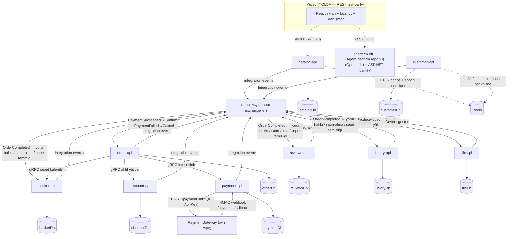

# ECommerceAgent — Olay-Güdümlü Kitapçı Backend'i

> Domain-Driven, olay-güdümlü mikroservis **kitapçı backend'i** (PDF-only dijital satış) — uçtan uca
> **.NET Aspire** ile orkestre. Yüzey büyük pivotta: MCP/BYO-agent duruşu söküldü, hedef
> **first-party React ekran + REST API + local LLM danışman** ile kişiselleştirilmiş keşif.

<p>
  
  
  
  
  
  
  
  
  
  
</p>

## Genel Bakış

Her servisin kendi veritabanına sahip, izole bir **bounded context** olduğu mikroservis backend'i.
Context'ler arası iletişim yalnızca **integration event** (RabbitMQ fanout; checkout dahil —
koreografi) ve — bir adımın anlık evet/hayır gerektirdiği yerde — sanksiyonlu **tipli gRPC**
(sepet kalemleri, aktif indirim, ödeme intent+link) üzerindendir.

**2026-10-30 temiz-sayfa pivotu:** katalog gerçek Kitapyurdu verisiyle (11.438 kitap, commit'li
`books.json`) dolar; ürün **PDF-only** satılır (Stock BC söküldü — envanter kavramı yok); eski
BYO-agent/MCP yüzeyi (tüm `/mcp` uçları, tool sabitleri, Mail.Mcp + NotificationAgent worker'ları)
ve Storefront+Elasticsearch araması söküldü. Domain davranışları aggregate'lerde duruyor; yeni yüzey
**REST first-party** olarak, arama **Catalog içinde pg-hibrit** (pg_search BM25 + pgvector + RRF)
olarak gelecek.

DDD, CQRS ve olay-güdümlü tasarımın gerçek .NET kodunda ne kadar ileri taşınabileceğini göstermek
için kurulmuş bir portföy / öğrenme projesidir.

## Bu proje neyi gösteriyor

- **Bounded-context izolasyonu** — kendi PostgreSQL veritabanı + Marten şeması olan **10 DB-sahibi
  bounded context**; kimlik makamı (IdP) ayrı **AgentPlatform** repo'sunda. Paylaşılan domain modeli
  yok; aynı kavram (*Ürün*) her context'te farklı modellenir.
- **Zengin aggregate'ler ve zorunlu invariant'lar** — iş kuralları handler'da değil aggregate'in
  içinde (private koleksiyon, davranış metotları). Geçersiz durumlar temsil edilemez.
- **Vertical Slice + CQRS** — kod feature'a göre örgütlenir; repository yok, handler doğrudan Marten
  `IDocumentSession` kullanır.
- **Exception yerine Result pattern** — beklenen hatalar tipli `Result` nesneleriyle akar.
- **Scope-tabanlı yetkilendirme** — kimlik OpenIddict + ASP.NET Identity (AgentPlatform IdP);
  servisler OAuth **scope**'larına göre yetkilendirir, hem HTTP uçlarında hem Wolverine handler'larında.
- **Checkout koreografisi** — merkezi orkestratör yok: `PaymentSucceeded → Order.Confirm →
  OrderCompleted` fanout (Reviews yorum-hakkı + Library satın-alma birikimi + Basket temizliği) /
  `PaymentFailed → Cancel`; her tüketim idempotent (durum-guard'lı), teknik hata retry → DLQ.
  Dijital pivotla stok commit ayağı kalktı — ödeme sonucu tek karar noktası.
- **Pay-by-link ödeme (094)** — kart alanı sistemden hiç geçmez: Order → Payment S2S gRPC ile
  intent+link, EC→PG `POST /payment-links` REST, PG→EC **HMAC webhook** (fail-closed, anti-tamper
  tutar guard'ı, idempotent). Ödeme dış PG hosted sayfasında olur, doğrulama sunucu tarafındadır.
- **JSON seed + kapak boru hattı (091/081)** — commit'li `books.json` açılışta katalogu satır satır
  doldurur (Gtin varsa atlar; ürün CANLI doğar, taslak/yayın ekseni yok); `ProductAdded` ile File BC
  kapağı R2'ye yazar, `CoverIngested` ile Catalog'a URL döner (`IFileStore`: R2/Local).
- **Satın-alma şartlı yorum** — hak `OrderCompleted` event'inden yerel projeksiyonla; yorum hemen
  görünür (moderasyon yok), özet okuma anında hesaplanır.
- **Bildirimsel caching + durable invalidation** — okuma sorguları `[Cached(...)]` attribute'uyla
  (HybridCache L1 + Redis L2); boşaltma **epoch-key** deseni: durable mesaj → Redis `INCR`,
  kesintide 2 dk aralıklı retry merdiveni, pod'lar arası L1 tutarlılığı pub/sub backplane.
- **Tek komutla orkestrasyon** — .NET Aspire her servisi, Postgres, RabbitMQ ve Redis'i service
  discovery + connection-string enjeksiyonuyla ayağa kaldırır.
- **Spec-driven development** — önemsiz olmayan feature'lar GitHub spec-kit akışıyla, proje
  anayasasının yönetiminde geliştirilir; her BC'nin domain süreci guard'lı `FLOW.md`'de.

## Mimari



Durum değişiklikleri RabbitMQ fanout exchange'lerinde **integration event** olarak yayınlanır.
Olaylar dışında senkron kanal sanksiyonlu **gRPC**'dir (`Shared/Protos`); tek HTTP istisnası dış
sağlayıcı webhook'u (PG ödeme callback'i) + File kapak serve/S2S uçlarıdır.

## Teknoloji Yığını

| Alan | Teknoloji |
|------|-----------|
| Çalışma zamanı | .NET 10, C# (nullable + implicit usings) |
| Orkestrasyon | .NET Aspire (AppHost + ServiceDefaults) |
| Kalıcılık | Marten (PostgreSQL document / event store) |
| Bus & messaging | Wolverine (CQRS bus + RabbitMQ fanout) |
| Caching | HybridCache (L1 bellek + Redis L2), AOP decorator; epoch-key durable invalidation |
| Kimlik & yetki | Platform IdP — **AgentPlatform repo'su** (OpenIddict + ASP.NET Identity; OIDC/OAuth, scope-tabanlı); ECommerce relying party (`Platform.Auth` paketi) |
| Senkron RPC | gRPC (sepet kalemleri, aktif indirim, ödeme intent+link) |
| Arama | *(YOLDA)* Catalog içi pg-hibrit — pg_search BM25 + pgvector + RRF |
| DI | Scrutor (konvansiyon-tabanlı otomatik kayıt) |
| Test | xUnit + Shouldly (saf domain birim testleri) |

## Servisler

| Proje | Sorumluluk |
|---------|----------------|
| `catalog-api` | Zengin `Product` + `Category` + `Author` + `Publisher` (kitap künyesi: yazar/çevirmen/sayfa/dil/tarih); first-party ürün yazımı — commit'li Kitapyurdu `books.json` seed açılışta satır satır (Gtin varsa atlar; ürün CANLI doğar) + fiyat geçmişi; kapak URL'i File'dan `CoverIngested`'le |
| `basket-api` | Kalıcı sepet + kalem; anonim sahiplik; stok kavramı yok (dijital); Order'a sepet-kalemleri gRPC sunucusu |
| `order-api` | Sipariş aggregate + yaşam döngüsü; pay-by-link başlatma yolu (gRPC istemcileri hazır, giriş yüzeyi REST'le gelecek); `PaymentSucceeded`→Confirm+`OrderCompleted` fanout / `PaymentFailed`→Cancel |
| `payment-api` | `PaymentIntent` durum makinesi (kart alanı yok, `TxRef` unique); Order S2S intent+link gRPC + EC→PG REST + PG→EC HMAC webhook → `PaymentSucceeded`/`PaymentFailed` fanout |
| `customer-api` | AddressBook (≤1 varsayılan invariant'ı); izole, event yaymaz; Order'a varsayılan-adres gRPC'si (uykuda) |
| `reviews-api` | Satın-alma şartlı yorum (1–5★); hak `OrderCompleted` event'inden; yorum hemen görünür, özet okuma anında |
| `library-api` | Kullanıcı-ürün ilgi kayıtları + fiyat alarmı aboneliği; `ProductChangedEvent.OldPrice` tetiği → `PriceAlarmTriggered`; `UserPurchase` satın-alma birikimi (`OrderCompleted` upsert) |
| `discount-api` | Admin kampanya indirimi: süzgeç (kategori/yazar/yayınevi/tek-kitap) → yüzde; kitap-başına tek indirim, süre dolunca temizler; fiyat tutmaz — Order'a gRPC aktif-yüzde |
| `file-api` | Kapak kayıt defteri: `FileAsset` (ImageName=ISBN unique) + çoklu fiziki depo (`IFileStore`: R2/Local); `ProductAdded` tüketir → kapağı yükler → `CoverIngested` yayar; anonim cover serve + S2S resolve |
| _(identity-server)_ | **AgentPlatform repo'sunda** (084): platform IdP — OIDC/OAuth + RBAC (rol = scope demeti); ECommerce relying party, AppHost proje-ref'i YOK |

Paylaşılan temeller `src/others` altında: `Common` (domain yapı taşları, result, caching, auth)
ve `Shared` (integration-event kontratları + gRPC protolar).

**Söküldü (gerekçeler `docs/adr/` + `specs/*`):** `stock-api` (dijital pivot), `storefront-api` +
Elasticsearch (arama pg-hibrit'e katlanıyor), tüm MCP yüzeyi + fasat aboneliği, `notification-agent`
+ `mail-mcp`, çok-tedarikçi besleme hattı, Checkout.Orchestrator (koreografiye geçildi).

## Öne Çıkan Tasarım Kararları

- **Bir mikroservis = bir bounded context.** Sınır fiziksel ve sert: ayrı veritabanı, ayrı şema,
  ayrı domain modeli. Servisler DB paylaşmaz, bir context'in modelini diğerine sızdırmaz.
- **Aggregate'ler invariant'larının sahibidir.** Yeni kural handler'a değil aggregate metoduna gider.
- **Exception yerine Result.** Handler, aggregate metodu ve endpoint `Result` döner.
- **Orkestrasyon yerine koreografi.** Checkout merkezi saga değil event zinciridir; her BC kendi
  tepkisinin sahibi, her tüketim idempotent, takılma durable mesaj + DLQ ile görünür.
- **Hosted ödeme.** Ödeme dış PG sayfasında olur; doğrulama sunucu tarafında (HMAC webhook).
  Kart verisi mağazaya hiç girmez.
- **Anlık evet/hayır gereken yerde senkron RPC.** Tipli gRPC, scope-korumalı, fail-closed;
  çağıran karşı servisin API'sine erişir, veritabanına değil.
- **Servisler arası transaction yerine idempotency.** Deterministik anahtarlar (`OrderId`/`TxRef`),
  en-az-bir-kez teslim, durum-guard'lı tüketim.
- **Rol downstream'e sızmaz — yalnız scope.** IdP rol verir (rol = scope demeti); servisler saf
  scope'a göre yetkilendirir.

## Dağıtım (CI/CD + k3s)

Üç repo (**ECommerceAgent** + **AgentPlatform** + **PaymentGateway**) tek bir **k3s** cluster'ına
(ayrı namespace), **GitHub Actions push-tabanlı CD** ile deploy edilir.

> **Not:** Temiz-sayfa pivotu sırasında CD hizası bilinçli askıda — manifest'ler sökülen servisleri
> hâlâ referans edebilir; cluster hizası yüzey pivotu oturunca yapılacak.

- **k3s tek-node** — hafif, pilleri-dahil (containerd + traefik + coredns).
- **Push-CD, SSH yolu** — k3s API internete kapalı; runner SSH'la `kubectl`'i sunucuda koşar.
- **Image:** `aspire do push` (Dockerfile'sız) → GHCR; kararlı `:latest` + `imagePullPolicy: Always`.
- **DNS/TLS:** sslip.io + cert-manager/Let's Encrypt.
- **Reverse-proxy kuralı:** ingress TLS arkasındaki servisler `ForwardedHeaders` yapılandırır —
  bkz. [`docs/conventions.md`](docs/conventions.md) + ADR.

Gerekçeler: **[`docs/adr/adr-k3s-push-cd-deployment.md`](docs/adr/adr-k3s-push-cd-deployment.md)**.

## Başlangıç

### Ön koşullar

- [.NET 10 SDK](https://dotnet.microsoft.com/)
- Docker (Aspire; PostgreSQL, RabbitMQ ve Redis'i container olarak sağlar)

### Tüm sistemi çalıştır

Dağıtık sistemi her zaman **Aspire AppHost** üzerinden başlat — servisler birbirini, veritabanlarını
ve RabbitMQ'yu Aspire service discovery ile bulur. Tek bir API'yi bağımsız çalıştırmak
bağımlılıklarını çözemez.

```bash
# Repo kökünden
dotnet run --project src/aspire/AppHost/AppHost.csproj
```

Kimlik makamı bu repo'da DEĞİLDİR — platform IdP'si `AgentPlatform` repo'sunun kendi AppHost'uyla
ayrıca başlatılır; korumalı yüzeyler token doğrulamayı ona (issuer URL) yapar.

> Platform IdP (AgentPlatform) **HTTPS** üzerinde çalışmalıdır (`SameSite=None; Secure` çerezleri
> düz HTTP'de sonsuz döner); servislerin `IdentityOption.Address`'i issuer URL'iyle birebir eşleşir.

### Derle & test et

```bash
dotnet build
dotnet test
dotnet test tests/Catalog.Api.Tests/Catalog.Api.Tests.csproj   # tek proje
```

## Proje Yapısı

```
src/
  aspire/        AppHost (orkestrasyon) + ServiceDefaults
  services/      basket, catalog, customer, discount, file,
                 library, order, payment, reviews
  others/        Common (yapı taşları, caching, auth), Shared (kontratlar + protolar)
tests/           Servis başına domain birim testleri (xUnit + Shouldly)
.specify/        Spec-driven development kurulumu (spec-kit)
specs/           Feature spec / plan / task'ları
```

Tek bir servis **Vertical Slice** düzeni izler:

```
Domains/<Aggregate>/
  <Aggregate>.cs                  # zengin aggregate root (fabrika + davranış metotları)
  <Aggregate>EndpointExtension.cs # Minimal API endpoint map'i
  Features/
    Commands/                     # yazma slice'ları  (IDocumentSession, [Transactional])
    Queries/                      # okuma slice'ları   (salt-okur)
```

Her bounded context ayrıca bir `FLOW.md` taşır — iş adımlarını, invariant'larını ve sınırını
EventStorming irtifasında anlatan domain-süreç belgesi, `scripts/check-flow-links.sh` ile guard'lı.

## Notlar

- **Central Package Management** açık — paket sürümleri `Directory.Packages.props`'ta yaşar.
- Önemsiz olmayan feature'lar **spec-kit** akışıyla (`/speckit-*`), `.specify/memory/` altındaki
  proje anayasasının yönetiminde geliştirilir.

---

*Domain-Driven mikroservislerin .NET yığınında pratik bir keşfi olarak inşa edildi.*
